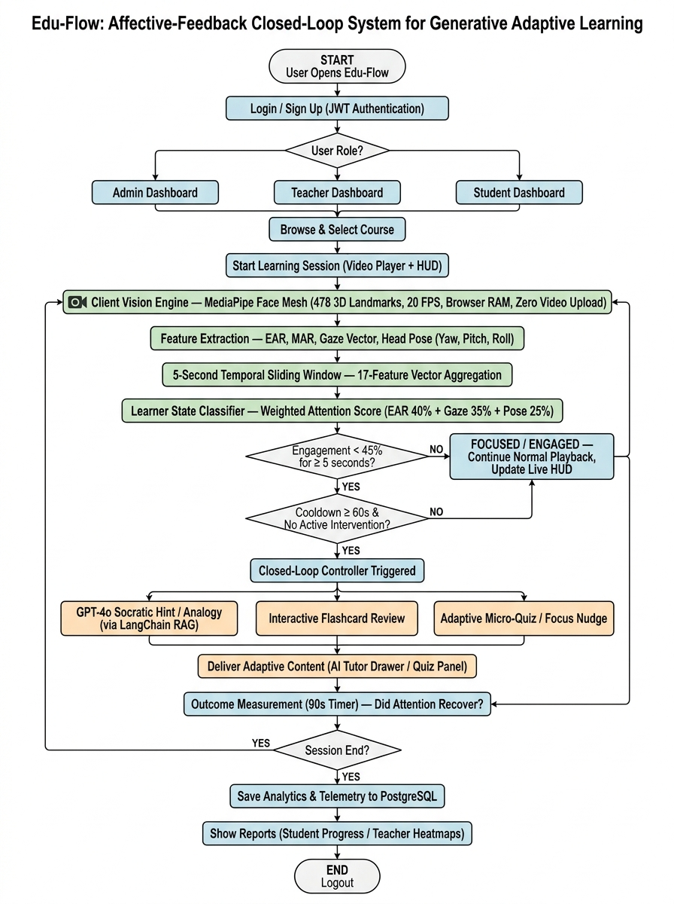
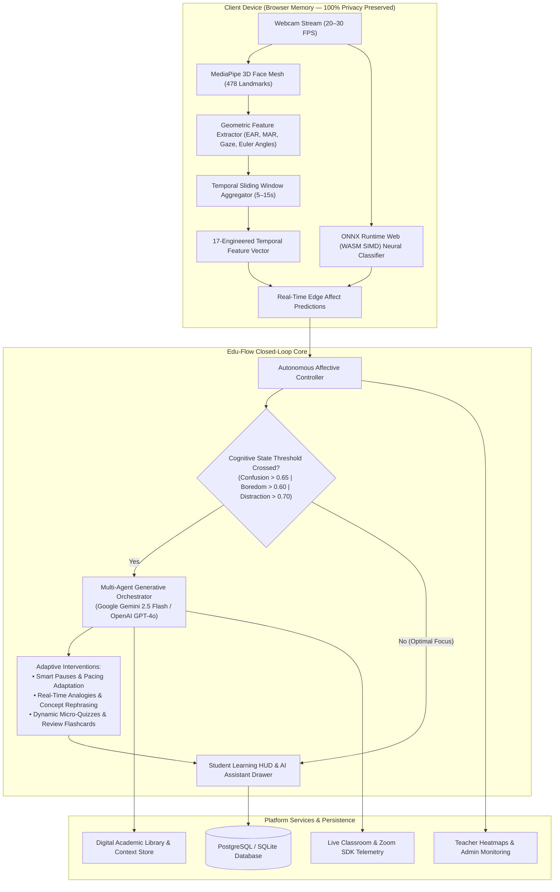

# 🎓 Edu-Flow: Affective-Feedback Closed-Loop System for Generative Adaptive Learning

[](https://python.org)
[](https://fastapi.tiangolo.com/)
[](https://react.dev/)
[](https://www.typescriptlang.org/)
[](https://ai.google.dev/)
[](https://openai.com/)
[](https://onnxruntime.ai/)
[](https://developers.google.com/mediapipe)
[](https://pytorch.org/)
[](https://tailwindcss.com/)
[](https://www.docker.com/)
[](LICENSE)

---

## 📌 Executive Overview

**Edu-Flow** is an enterprise-grade, privacy-first adaptive learning ecosystem that pioneers a **closed-loop affective feedback cycle**. It unifies real-time edge computer vision, hybrid machine learning state classification (MediaPipe + ONNX WebAssembly neural inference), and Generative AI (Google Gemini & OpenAI GPT-4o) with Retrieval-Augmented Generation (RAG).

By continuously analyzing cognitive load, attention variance, boredom, confusion, and distraction at **20–30 FPS entirely in transient client browser memory**, Edu-Flow automatically adjusts pedagogical content, presents dynamic micro-quizzes, offers interactive flashcards, adapts video pacing, and provides contextual AI tutor interventions tailored to each learner's immediate mental state.

---

## 🏗️ System Architecture & Closed-Loop Flow

Edu-Flow operates on an autonomous closed-loop control system:





---

## ✨ Key Features & Capabilities

### 🛡️ Privacy-First Client-Side Vision Engine
- **Zero Video Transmission**: Raw webcam pixels are processed strictly inside client browser RAM using MediaPipe 478 Face Mesh and ONNX Runtime WebAssembly SIMD. No raw video feed or individual frame pixels are ever transmitted over the network.
- **Edge Geometric Extraction**: Calculates Eye Aspect Ratio (EAR), Mouth Aspect Ratio (MAR), Gaze Vector dispersion, and Head Pose Euler angles (Pitch, Yaw, Roll) entirely on the client.
- **Neural Edge Inference**: Runs browser-native deep affective classification models (`eduflow_daisee.onnx` & `affect_model.onnx`) directly through WebAssembly SIMD threads at 20+ FPS.

### 🧠 Hybrid Multimodal Machine Learning Pipeline
- **17 Engineered Temporal Features**: Combines ocular dynamics, blink rates, gaze deviation durations, head stability indices, yawn frequencies, and user platform interactions (scrubbing, clicks, quiz latency).
- **8 Distinct Learner States**: Real-time classification into `FOCUSED`, `ENGAGED`, `LOW_ENGAGEMENT`, `DISTRACTION`, `POSSIBLE_MIND_WANDERING`, `NEEDS_SUPPORT`, `FACE_NOT_DETECTED`, and `INACTIVE`.
- **DAiSEE Dataset Fine-Tuning**: Dedicated PyTorch training and evaluation pipeline fine-tuned on the DAiSEE affective dataset, exportable directly to ONNX for web runtime.
- **Dual-Engine Server Verification**: Fallback / server-side verification endpoint (`/api/v1/affective/analyze-frame`) for multi-platform telemetry validation.

### 🤖 Multi-Agent Generative AI & RAG Orchestration
- **Dual AI Provider Support**: Seamless switching between **Google Gemini (Gemini 2.5 Flash / 1.5 Flash via `google-genai`)** and **OpenAI (GPT-4o / GPT-4o-mini)**.
- **Dynamic Quiz Agent**: Generates contextual, bite-sized assessment questions on the fly from current lecture material with duplicate suppression and question banking.
- **Affective Intervention Engine**: Automatically executes targeted interventions when confusion, distraction, or high cognitive load is detected.
- **Interactive AI Study Assistant**: Embedded right inside the video player and digital library, allowing students to ask questions, generate summaries, and test their understanding.

### 📚 Digital Academic Library
- Curated curriculum reading system across Computer Science, AI/ML, Mathematics, and Data Science.
- Interactive reader modal supporting rich Markdown, LaTeX equations, key concepts chips, and citation indexing.
- Embedded **Gemini Study Assistant** for instant document summarization, guided explanations, and concept comprehension checks.

### 🎥 Live Classes & Virtual Classroom
- Interactive live classroom sessions with Zoom SDK integration.
- Real-time participant affect monitoring and class-level engagement telemetry.
- Direct lecture scheduling and meeting room management for teachers and administrators.

### 👥 Comprehensive Role-Based Portals (RBAC)

| Portal | Core Functionality |
| :--- | :--- |
| 🎓 **Student Portal** | Interactive lecture player, real-time HUD affect telemetry, closed-loop interventions, dynamic micro-quizzes, review flashcards, course streak counter, leaderboard, completion certificates, and user profile management. |
| 👨‍🏫 **Teacher Portal** | Real-time temporal affect heatmaps, student roster engagement scores, course & module builder, video uploader, intervention resolution tracking, and AI-generated classroom digests. |
| ⚙️ **Admin Portal** | System health monitoring (CPU, RAM, API latencies), user management (Students, Teachers, Admins), course approval, live class scheduling, and security audit logs. |

---

## 📊 ML Feature Schema (17 Engineered Features)

The temporal feature aggregation engine computes a 17-dimensional vector across rolling windows:

| Index | Feature | Unit / Range | Description |
| :---: | :--- | :---: | :--- |
| **0** | `mean_ear` | $[0.0, 1.0]$ | Mean Eye Aspect Ratio (detects eye openness) |
| **1** | `ear_variance` | $[0.0, 0.1]$ | Variance of EAR (differentiates blinks from drowsiness) |
| **2** | `blink_rate` | $[0.0, 60.0]$ | Blinks per minute |
| **3** | `prolonged_closure_ratio`| $[0.0, 1.0]$ | Ratio of window with eyes closed $> 500\text{ms}$ |
| **4** | `gaze_center_ratio` | $[0.0, 1.0]$ | Proportion of window gaze was centered on screen |
| **5** | `gaze_away_duration_sec`| $[0.0, 60.0]$ | Cumulative seconds gaze deviated from content |
| **6** | `head_yaw_mean` | $[-90^{\circ}, 90^{\circ}]$ | Mean horizontal head rotation |
| **7** | `head_pitch_mean` | $[-90^{\circ}, 90^{\circ}]$ | Mean vertical head tilt (nodding/drooping) |
| **8** | `head_roll_mean` | $[-90^{\circ}, 90^{\circ}]$ | Mean lateral head tilt |
| **9** | `head_stability_score` | $[0.0, 1.0]$ | Stability index derived from Euler angle variance |
| **10**| `mouth_open_ratio` | $[0.0, 1.0]$ | Proportion of window with Mouth Aspect Ratio $\ge 0.40$ |
| **11**| `yawn_frequency_cpm` | $[0.0, 10.0]$ | Confirmed yawns per minute ($\text{MAR} \ge 0.60$ for $\ge 1.5\text{s}$) |
| **12**| `face_presence_ratio` | $[0.0, 1.0]$ | Proportion of window face mesh was tracked |
| **13**| `interaction_rate_cpm` | $[0.0, 120.0]$ | Platform interactions (clicks, keystrokes) per minute |
| **14**| `video_active_ratio` | $[0.0, 1.0]$ | Proportion of window lecture video was playing |
| **15**| `recent_quiz_score` | $[0.0, 1.0]$ | Accuracy on most recent quiz attempt ($1.0$ if unattempted) |
| **16**| `time_since_interaction_sec` | $[0.0, 3600.0]$ | Seconds elapsed since last user interaction |

---

## 🛠️ Technology Stack

| Layer | Technology | Key Libraries / Modules |
| :--- | :--- | :--- |
| **Frontend Client** | React 19, TypeScript, Vite | Tailwind CSS, Framer Motion, Recharts, Lucide Icons, Canvas Confetti, Chart.js |
| **Edge Vision & AI** | MediaPipe, ONNX Runtime Web | `@mediapipe/face_mesh`, `@mediapipe/camera_utils`, `onnxruntime-web` (WASM SIMD) |
| **Backend API** | FastAPI, Python 3.11+ | Uvicorn, SQLAlchemy, Alembic, Pydantic v2, PyJWT, AsyncPG |
| **GenAI & RAG** | Google Gemini, OpenAI GPT-4o | `google-genai`, `langchain`, `langgraph`, RAG vector embeddings, PyPDF |
| **ML & Deep Learning** | PyTorch, Scikit-learn, OpenCV | `torch`, `torchvision`, `onnx`, `joblib`, `opencv-contrib-python`, `pandas`, `numpy` |
| **Live Streaming** | Zoom SDK / WebRTC | Zoom Video SDK integration, WebSockets |
| **Task Queue & Cache** | Celery, Redis | `celery`, `redis` broker & caching |
| **Persistence** | PostgreSQL / SQLite | SQLAlchemy 2.0 ORM, Alembic migrations |
| **Containerization** | Docker | Docker Compose, Nginx reverse proxy |

---

## 📂 Repository Directory Structure

```
eduflow/
├── backend/                       # FastAPI Application Core
│   ├── alembic/                  # Database Migration Scripts
│   ├── app/
│   │   ├── api/v1/               # REST Endpoints
│   │   │   ├── admin.py          # Admin System Health, Users, & Audits
│   │   │   ├── affective.py      # Telemetry & Frame Analysis Endpoints
│   │   │   ├── ai_tutor.py       # Conversational AI Tutor
│   │   │   ├── auth.py           # JWT Authentication & Tokens
│   │   │   ├── courses.py        # Course & Module CRUD Operations
│   │   │   ├── live_classes.py   # Live Classrooms & Zoom SDK Sessions
│   │   │   ├── quizzes.py        # Micro-Quiz Generation & Scoring
│   │   │   ├── teacher.py        # Teacher Affect Analytics & Heatmaps
│   │   │   ├── users.py          # User Profiles & Avatars
│   │   │   └── videos.py         # Video Uploads & Media Streaming
│   │   ├── core/                 # Config, Database Engine, Security
│   │   ├── models/               # SQLAlchemy ORM Models
│   │   ├── schemas/              # Pydantic v2 Validation Schemas
│   │   ├── services/             # Business Logic & AI Engines
│   │   │   ├── agents/           # Specialized Agents (Quiz Agent, RAG)
│   │   │   ├── ai_provider.py    # Gemini & OpenAI Provider Abstraction
│   │   │   ├── gemini_service.py # Google Gemini 2.5 Flash Integration
│   │   │   ├── intervention_engine.py # Closed-Loop Adaptive Interventions
│   │   │   └── opencv_vision.py  # Server-side Computer Vision Engine
│   │   └── seed_courses.py       # Showcase Courses & Curriculum Seeder
│   ├── Dockerfile                # Backend Container Specification
│   ├── main.py                   # FastAPI Entry Point & Middleware
│   ├── requirements.txt          # Python Dependencies
│   └── test_affective_api.py     # End-to-End Affective API Test Suite
├── frontend/                      # React 19 + TypeScript + Vite Client
│   ├── public/
│   │   ├── models/affective/     # Client-Side ONNX Neural Models (.onnx / .data)
│   │   └── ort-wasm/             # ONNX Runtime WebAssembly SIMD Binaries
│   ├── src/
│   │   ├── components/
│   │   │   ├── common/           # Navbar, Sidebar, CourseCard, ProtectedRoute
│   │   │   ├── library/          # Document Reader Modal, Gemini Study Assistant
│   │   │   ├── student/          # Learning Player, AI Assistant Panel, HUD
│   │   │   └── teacher/          # Student Analytics Table, Affect Heatmaps
│   │   ├── context/              # AffectiveContext & AuthContext
│   │   ├── pages/                # Route Views (Student, Teacher, Admin, Library)
│   │   ├── services/             # Affect Inference, Attention Monitor, API Client
│   │   ├── utils/                # Digital Library Curricula & Content Service
│   │   └── types/                # TypeScript Interfaces & State Enums
│   ├── Dockerfile                # Frontend Container Specification
│   ├── package.json              # Node Dependencies & Scripts
│   ├── tailwind.config.js        # Design System & Styling
│   └── vite.config.ts            # Vite Configuration & WASM MIME Routing
├── ml/                            # Machine Learning & Deep Learning Pipeline
│   ├── data/                     # Raw & Processed Tabular Datasets
│   ├── export/                   # ONNX Web Exporter (export_model.py)
│   ├── models/                   # PyTorch Affective Architectures & Weights
│   └── tuning/                   # DAiSEE Dataset Fine-Tuning Pipeline
├── docker-compose.yml             # Full-Stack Multi-Container Orchestration
├── eduflow_flowchart.jpg          # System Architecture Flowchart
├── nginx.conf                     # Production Reverse Proxy Configuration
└── README.md                      # System Documentation
```

---

## 🚀 Quick Start Guide

### Prerequisites

Ensure you have the following installed on your system:
- **Node.js**: `v18.0.0` or higher
- **Python**: `v3.11` or higher
- **Docker & Docker Compose**: (Optional, for containerized execution)

---

### Option A: Running with Docker Compose (Recommended)

1. **Clone the Repository**:
   ```bash
   git clone https://github.com/nimishsuhaasmc05/eduflow.git
   cd eduflow
   ```

2. **Configure Environment Variables**:
   ```bash
   cp .env.example .env
   ```
   *Edit `.env` to supply your `GEMINI_API_KEY` (or `OPENAI_API_KEY`) and secret keys.*

3. **Spin up All Services**:
   ```bash
   docker-compose up --build
   ```

4. **Access the Applications**:
   - **Frontend Application**: `http://localhost`
   - **Backend API Interactive Docs**: `http://localhost:8000/docs`

---

### Option B: Running Locally (Manual Development Setup)

#### 1. Backend Setup

```bash
cd backend

# Create & activate Python virtual environment
python3 -m venv venv
source venv/bin/activate       # On Windows: venv\Scripts\activate

# Install dependencies
pip install -r requirements.txt

# Run database migrations
python -m alembic upgrade head

# Seed demo courses and default users
python -m app.seed_courses

# Launch FastAPI development server
uvicorn main:app --reload --port 8000
```
*Interactive Swagger UI is live at `http://localhost:8000/docs`.*

#### 2. Frontend Setup

```bash
cd frontend

# Install Node dependencies
npm install

# Start Vite dev server
npm run dev
```
*Frontend Application will be live at `http://localhost:5173`.*

---

## 🔬 Machine Learning Workflows

### 1. Fine-Tune Affective Model on DAiSEE
Train and fine-tune the multi-task affective classification network:
```bash
python -m ml.tuning.tune_daisee --epochs 5 --batch_size 16 --lr 0.001
```

### 2. Export Model to Client-Side ONNX Web Format
Export trained PyTorch weights into optimized ONNX WebAssembly format for in-browser execution:
```bash
python -m ml.export.export_model \
    --checkpoint ./ml/models/eduflow_daisee_tuned.pth \
    --onnx_out ./frontend/public/models/affective/eduflow_daisee.onnx
```

### 3. Verify Server Affective API
Validate the dual-engine classification endpoints using synthetic face markers:
```bash
python backend/test_affective_api.py
```

---

## 🔑 Demo Login Credentials

For testing and demonstration, use the following pre-seeded accounts:

| Portal | Username / Email | Password | Role Description |
| :--- | :--- | :--- | :--- |
| **Student Portal** | `student@eduflow.ai` | `student123` | Access interactive learning player, live HUD, AI Tutor, quizzes, library & certificates |
| **Teacher Portal** | `teacher@eduflow.ai` | `teacher123` | Monitor class affect heatmaps, upload course materials, manage live sessions |
| **Admin Portal** | `admin@eduflow.ai` | `admin123` | System monitoring, user role management, course approval, security audit logs |

---

## ⚙️ Environment Variables Reference

Key settings configurable via `.env`:

| Variable | Default Value | Description |
| :--- | :--- | :--- |
| `SECRET_KEY` | `eduflow-super-secret-jwt-key-...` | Secret key used for signing JWT tokens |
| `ALGORITHM` | `HS256` | JWT Hashing Algorithm |
| `ACCESS_TOKEN_EXPIRE_MINUTES` | `1440` | JWT token validity in minutes (24 hours) |
| `DATABASE_URL` | `postgresql+psycopg://...` | Connection string (PostgreSQL or SQLite) |
| `REDIS_URL` | `redis://localhost:6379/0` | Redis caching and background task broker |
| `AI_PROVIDER` | `gemini` | Primary AI provider (`gemini` or `openai`) |
| `GEMINI_API_KEY` | `""` | Google Gemini API Key for AI Tutor & dynamic quizzes |
| `GEMINI_MODEL` | `gemini-2.5-flash` | Gemini model name (`gemini-2.5-flash`, `gemini-1.5-flash`) |
| `OPENAI_API_KEY` | `""` | OpenAI API Key (optional alternative) |
| `OPENAI_MODEL` | `gpt-4o-mini` | OpenAI model name (`gpt-4o`, `gpt-4o-mini`) |
| `ZOOM_SDK_KEY` | `eduflow_zoom_sdk_key_2026` | Zoom Video SDK Client Key |
| `ZOOM_SDK_SECRET` | `eduflow_zoom_sdk_secret_2026` | Zoom Video SDK Client Secret |
| `CONFUSION_THRESHOLD` | `0.65` | Trigger score threshold for Confusion interventions |
| `DISTRACTION_THRESHOLD` | `0.70` | Trigger score threshold for Distraction interventions |
| `BOREDOM_THRESHOLD` | `0.60` | Trigger score threshold for Boredom interventions |
| `HIGH_COGNITIVE_LOAD_THRESHOLD` | `0.75` | Trigger score threshold for High Cognitive Load adjustments |

---

## 🧪 Verification & Testing

Edu-Flow includes test suites across backend APIs, machine learning pipelines, and frontend components:

```bash
# 1. Run backend unit & integration tests
cd backend
pytest

# 2. Test affective telemetry & frame analysis endpoints
python test_affective_api.py

# 3. Frontend TypeScript checking & production bundle validation
cd ../frontend
npm run build
```

---

## 🔒 Privacy, Safety & Ethical Guidelines

1. **Strict Client-Side Boundary**: Video frames are processed strictly in transient browser RAM using WebAssembly SIMD and MediaPipe. No raw video feed or individual frame pixels are ever transmitted across the network.
2. **No Facial Recognition or Biometric ID**: The system extracts relative geometric ratios (EAR, MAR, Euler angles) and does not calculate, construct, or store facial identification vectors or persistent biometric templates.
3. **Educational Context Scope**: Classification results refer strictly to learning state behavior (`FOCUSED`, `NEEDS_SUPPORT`, `POSSIBLE_MIND_WANDERING`, etc.) and avoid making medical or diagnostic claims.

---

## 📜 License

Distributed under the **MIT License**. See [LICENSE](LICENSE) for details.
