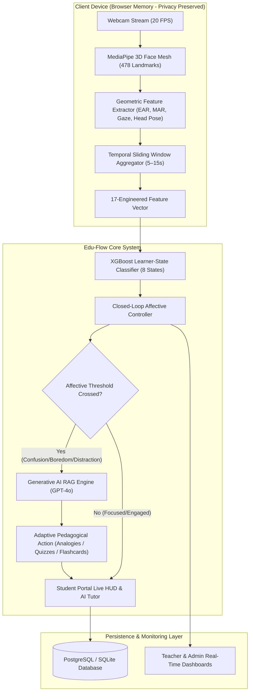

# 🎓 Edu-Flow: Affective-Feedback Closed-Loop System for Generative Adaptive Learning

[](https://python.org)
[](https://fastapi.tiangolo.com/)
[](https://react.dev/)
[](https://www.typescriptlang.org/)
[](https://tailwindcss.com/)
[](https://xgboost.readthedocs.io/)
[](https://www.docker.com/)
[](LICENSE)

---

## 📌 Executive Overview

**Edu-Flow** is an enterprise-grade, privacy-first adaptive learning platform that combines real-time client-side computer vision, machine learning state classification, and Generative AI (OpenAI GPT-4o with Retrieval-Augmented Generation) to create a **closed-loop affective feedback system**.

By continuously analyzing learner attention, confusion, boredom, distraction, and cognitive load at **20 FPS in browser memory**, Edu-Flow automatically adjusts pedagogical content, presents dynamic micro-quizzes, offers interactive flashcards, and provides AI tutor interventions tailored to each student's immediate cognitive state.

---

## 🏗️ System Architecture & Closed-Loop Flow



---

## ✨ Key Features

### 🛡️ Privacy-First Client Vision Engine
- **Zero Video Transmission**: Raw webcam pixels are processed strictly inside client browser memory using MediaPipe Face Mesh (478 landmarks) and immediately discarded.
- **Edge Analytics**: Calculates Eye Aspect Ratio (EAR), Mouth Aspect Ratio (MAR), Gaze Vector, and Head Pose Euler angles locally.

### 🧠 Multimodal XGBoost Machine Learning Pipeline
- **17 Engineered Temporal Features**: Aggregates physical ocular/head metrics with interactive platform actions (mouse movements, quiz speed, video controls).
- **8 Learner States**: Classifies state into `FOCUSED`, `ENGAGED`, `LOW_ENGAGEMENT`, `DISTRACTION`, `POSSIBLE_MIND_WANDERING`, `NEEDS_SUPPORT`, `FACE_NOT_DETECTED`, or `INACTIVE`.
- **Zero Data Leakage**: Subject-level partitioned dataset splitting (~70% Train / 15% Val / 15% Test).

### 🤖 Closed-Loop Generative AI & RAG Engine
- **Real-Time Intervention**: Triggered when affective metrics cross configured thresholds (e.g., `CONFUSION > 0.65`, `DISTRACTION > 0.70`).
- **GPT-4o Integration**: Dynamically generates tailored explanations, analogies, micro-quizzes, and interactive review flashcards grounded in course context.

### 👥 Role-Based Portals (RBAC)
- 🎓 **Student Portal**:
  - Video lecture player with real-time HUD affect telemetry.
  - Interactive AI Tutor drawer with course RAG context.
  - Dynamic micro-quizzes, review flashcards, learning streaks, and completion certificates.
- 👨‍🏫 **Teacher Portal**:
  - Class-wide temporal affect heatmaps and student roster engagement scores.
  - Course upload & automatic document chunking/vectorization.
  - AI-generated daily/weekly classroom performance digests.
- ⚙️ **Admin Portal**:
  - System health indicators, API latency tracking, and queue metrics.
  - User role assignment and security audit logs.
  - Database backup and migration controls.

---

## 📊 ML Feature Schema (17 Engineered Features)

The XGBoost inference engine expects a 17-feature vector structured as follows:

| Index | Feature | Unit / Range | Description |
| :---: | :--- | :---: | :--- |
| **0** | `mean_ear` | $[0.0, 1.0]$ | Mean Eye Aspect Ratio (detects eye opening) |
| **1** | `ear_variance` | $[0.0, 0.1]$ | Variance of EAR (differentiates blinks from drowsiness) |
| **2** | `blink_rate` | $[0.0, 60.0]$ | Estimated blinks per minute |
| **3** | `prolonged_closure_ratio`| $[0.0, 1.0]$ | Ratio of window with eyes closed $> 500\text{ms}$ |
| **4** | `gaze_center_ratio` | $[0.0, 1.0]$ | Proportion of window gaze was centered on screen |
| **5** | `gaze_away_duration_sec`| $[0.0, 60.0]$ | Cumulative seconds gaze deviated from content |
| **6** | `head_yaw_mean` | $[-90^{\circ}, 90^{\circ}]$ | Mean horizontal head rotation |
| **7** | `head_pitch_mean` | $[-90^{\circ}, 90^{\circ}]$ | Mean vertical head tilt (nodding/drooping) |
| **8** | `head_roll_mean` | $[-90^{\circ}, 90^{\circ}]$ | Mean lateral head tilt |
| **9** | `head_stability_score` | $[0.0, 1.0]$ | Stability index derived from Euler angle variance |
| **10**| `mouth_open_ratio` | $[0.0, 1.0]$ | Proportion of window with Mouth Aspect Ratio $\ge 0.40$ |
| **11**| `yawn_frequency_cpm` | $[0.0, 10.0]$ | Confirmed yawns per minute ($\text{MAR} \ge 0.60$ for $\ge 1.5\text{s}$) |
| **12**| `face_presence_ratio` | $[0.0, 1.0]$ | Proportion of window face mesh was tracked |
| **13**| `interaction_rate_cpm` | $[0.0, 120.0]$ | Platform interactions (clicks, keystrokes) per minute |
| **14**| `video_active_ratio` | $[0.0, 1.0]$ | Proportion of window lecture video was playing |
| **15**| `recent_quiz_score` | $[0.0, 1.0]$ | Accuracy on most recent quiz attempt ($1.0$ if unattempted) |
| **16**| `time_since_interaction_sec` | $[0.0, 3600.0]$ | Seconds elapsed since last user interaction |

---

## 🛠️ Technology Stack

| Layer | Technology | Key Libraries / Modules |
| :--- | :--- | :--- |
| **Frontend UI** | React 19, TypeScript, Vite | Tailwind CSS, Framer Motion, Recharts, Lucide Icons, Canvas Confetti |
| **Edge Vision** | MediaPipe Face Mesh | `@mediapipe/face_mesh`, `@mediapipe/camera_utils` |
| **Backend API** | FastAPI, Python 3.11+ | Uvicorn, SQLAlchemy, Alembic, Pydantic v2, PyJWT |
| **ML Engine** | XGBoost | Scikit-learn, OpenCV, Pandas, NumPy, Joblib |
| **GenAI & RAG** | OpenAI GPT-4o, LangChain | Embeddings, Vector Stores, PyPDF |
| **Async Jobs** | Celery, Redis | Redis Server, Celery Workers |
| **Database** | PostgreSQL / SQLite | AsyncPG, Psycopg3, SQLite3 |
| **Containerization** | Docker | Docker Compose, Nginx |

---

## 📂 Repository Directory Structure

```
Edu-Flow/
├── backend/                  # FastAPI Application Core
│   ├── app/
│   │   ├── api/v1/          # REST Endpoints (Auth, Users, Courses, Telemetry, AI Tutor)
│   │   ├── core/            # Config, Security, JWT Settings
│   │   ├── db/              # SQLAlchemy Database Models & Sessions
│   │   ├── schemas/         # Pydantic Request/Response Schemas
│   │   ├── services/        # Business Logic & AI Closed-Loop Services
│   │   └── workers/         # Celery Async Background Tasks
│   ├── alembic/             # Database Migration Scripts
│   ├── Dockerfile           # Backend Container Specification
│   ├── main.py              # Application Entry Point & Middleware
│   └── requirements.txt     # Python Dependencies
├── frontend/                 # React + Vite Client Application
│   ├── src/
│   │   ├── components/      # UI Components (Student, Teacher, Admin, Navigation)
│   │   ├── pages/           # Application Routes & Dashboards
│   │   ├── services/        # Axios API Client & Vision Signal Processing
│   │   └── context/         # React Context (Auth, Telemetry State)
│   ├── Dockerfile           # Frontend Container Specification
│   ├── package.json         # Node Dependencies & Scripts
│   └── tailwind.config.js   # Style Customization
├── ml/                       # XGBoost Machine Learning Pipeline
│   ├── data/                # Raw & Processed Tabular Datasets
│   ├── evaluation/          # Confusion Matrix & Performance Metrics
│   ├── inference/           # Production XGBoost Predictor Engine
│   ├── models/              # Saved Serialized XGBoost Models (.joblib/.json)
│   ├── preprocessing/       # Landmark Extraction & Temporal Aggregation
│   ├── training/            # Pipeline Trainer with Subject Splitting
│   └── feature_schema.py    # 17-Feature Schema Definitions
├── scratch/                  # Integration & Verification Test Suites
├── docker-compose.yml        # Full-Stack Multi-Container Orchestration
├── nginx.conf                # Production Reverse Proxy Configuration
└── README.md                 # System Documentation
```

---

## 🚀 Quick Start Guide

### Prerequisites

Ensure you have the following installed on your system:
- **Node.js**: `v18.0.0` or higher
- **Python**: `v3.11` or higher
- **Docker & Docker Compose**: (Optional, for containerized execution)

---

### Option A: Running with Docker Compose (Recommended)

1. **Clone the Repository & Navigate to Project**:
   ```bash
   git clone https://github.com/your-org/edu-flow.git
   cd edu-flow
   ```

2. **Configure Environment Variables**:
   ```bash
   cp .env.example .env
   ```
   *Edit `.env` to supply your `OPENAI_API_KEY` and secret keys.*

3. **Spin up All Services**:
   ```bash
   docker-compose up --build
   ```

4. **Access the Applications**:
   - **Frontend App**: `http://localhost`
   - **Backend API Docs**: `http://localhost:8000/docs`

---

### Option B: Running Locally (Manual Development Setup)

#### 1. Backend Setup

```bash
cd backend

# Create & activate Python virtual environment
python -m venv venv

# On Windows:
venv\Scripts\activate
# On Linux/macOS:
source venv/bin/activate

# Install dependencies
pip install -r requirements.txt

# Run database migrations
python -m alembic upgrade head

# Launch FastAPI development server
uvicorn main:app --reload --port 8000
```
*API Swagger Documentation will be live at `http://localhost:8000/docs`.*

#### 2. Frontend Setup

```bash
cd frontend

# Install Node dependencies
npm install

# Start Vite dev server
npm run dev
```
*Frontend Application will be live at `http://localhost:5173`.*

#### 3. Machine Learning Pipeline Setup (Optional)

```bash
# Train XGBoost Model on benchmark / processed dataset
python -m ml.training.train_xgboost

# Evaluate trained model
python -m ml.evaluation.evaluate_xgboost
```

---

## 🔑 Demo Login Credentials

For testing and demonstration, use the following pre-seeded accounts:

| Portal | Username / Email | Password | Role Description |
| :--- | :--- | :--- | :--- |
| **Student Portal** | `student@eduflow.ai` | `student123` | Access interactive learning player, live HUD, AI Tutor, quizzes & certificates |
| **Teacher Portal** | `teacher@eduflow.ai` | `teacher123` | Monitor class affect heatmaps, upload course materials, generate AI digests |
| **Admin Portal** | `admin@eduflow.ai` | `admin123` | View system health analytics, manage user roles, audit security logs |

---

## ⚙️ Environment Variables Reference

Key settings configurable via `.env`:

| Variable | Default Value | Description |
| :--- | :--- | :--- |
| `SECRET_KEY` | `your-secret-key` | JWT Signing Secret |
| `ALGORITHM` | `HS256` | JWT Hashing Algorithm |
| `ACCESS_TOKEN_EXPIRE_MINUTES` | `1440` | Token validity duration in minutes (24h) |
| `DATABASE_URL` | `postgresql+psycopg://...` | Database connection string (PostgreSQL or SQLite) |
| `REDIS_URL` | `redis://localhost:6379/0` | Redis cache and Celery broker URL |
| `OPENAI_API_KEY` | `sk-...` | OpenAI API key for GPT-4o & RAG features |
| `CONFUSION_THRESHOLD` | `0.65` | Trigger score threshold for Confusion interventions |
| `DISTRACTION_THRESHOLD` | `0.70` | Trigger score threshold for Distraction interventions |
| `BOREDOM_THRESHOLD` | `0.60` | Trigger score threshold for Boredom interventions |
| `HIGH_COGNITIVE_LOAD_THRESHOLD` | `0.75` | Trigger score threshold for High Cognitive Load adjustments |

---

## 🧪 Verification & Testing

Edu-Flow includes automated test suites covering authentication, course management, video telemetry, and ML inference:

```bash
# Run backend pytest suite
cd backend
pytest

# Run frontend type checking & linting
cd frontend
npm run lint
npm run build

# Run end-to-end integration suite
python scratch/run_full_end_to_end_suite.py
```

---

## 🔒 Privacy, Safety & Ethical Guidelines

1. **Strict Client-Side Boundary**: Video frames are processed strictly in transient browser RAM. No raw video feed or individual frame pixels are transmitted across the network.
2. **No Facial Recognition**: The system extracts relative geometric ratios (EAR, MAR, Euler angles) and does not calculate or store biometric facial identification templates.
3. **Educational Context Scope**: Classification results refer strictly to learning state behavior (`FOCUSED`, `NEEDS_SUPPORT`, etc.) and avoid making medical or diagnostic claims.

---

## 📜 License

Distributed under the **MIT License**. See `LICENSE` for details.

